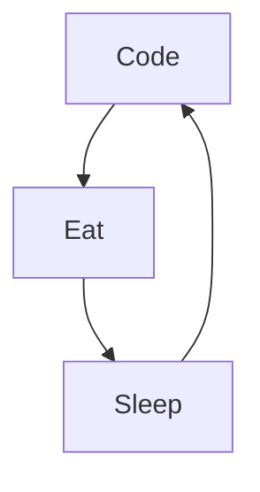

# Joel

# Hi, I'm Joel 👋

### Software Engineer | Transitioning into Cloud & DevOps ☁️

I'm a software engineer with experience building web applications and supporting software solutions in the banking and financial services sector.

I'm currently expanding my skills in **Cloud Computing, DevOps, CI/CD automation, and infrastructure management**, with the goal of building reliable, scalable, and automated deployment environments.

## 🚀 About Me

- 💻 Background in software engineering and full-stack development
- 🏦 Experience working on digital banking and payment solutions
- ☁️ AWS Certified Cloud Practitioner
- 📚 Currently developing my skills in Cloud and DevOps engineering
- 🎯 Goal: Become a Cloud DevOps Engineer and build practical, production-oriented infrastructure projects

## 🛠️ Technologies & Tools

**Development**
- JavaScript, TypeScript, Java
- Angular, Node.js

**Cloud & DevOps — Learning and Practice**
- AWS
- Linux
- Git & GitLab CI/CD
- Docker
- Kubernetes
- Infrastructure as Code

## 🔬 What I'm Working On

I'm building hands-on projects to strengthen my understanding of:

- Cloud infrastructure and deployment
- CI/CD pipeline automation
- Containerization and orchestration
- Infrastructure automation and configuration management
- Monitoring, troubleshooting, and system reliability

Check out my repositories to follow my learning journey and practical implementations.

## 📈 My Goal

To combine my software engineering background with Cloud and DevOps practices to help teams deliver applications more reliably, efficiently, and securely.

**Learn by building. Automate what can be automated. Improve continuously.**

---

*Always learning, always building.* 🚀

Actually:

<!--
**Kpoti20/Kpoti20** is a ✨ _special_ ✨ repository because its `README.md` (this file) appears on your GitHub profile.

Here are some ideas to get you started:

- 🔭 I’m currently working on ...
- 🌱 I’m currently learning ...
- 👯 I’m looking to collaborate on ...
- 🤔 I’m looking for help with ...
- 💬 Ask me about ...
- 📫 How to reach me: ...
- 😄 Pronouns: ...
- ⚡ Fun fact: ...
-->

### My daily routine :

